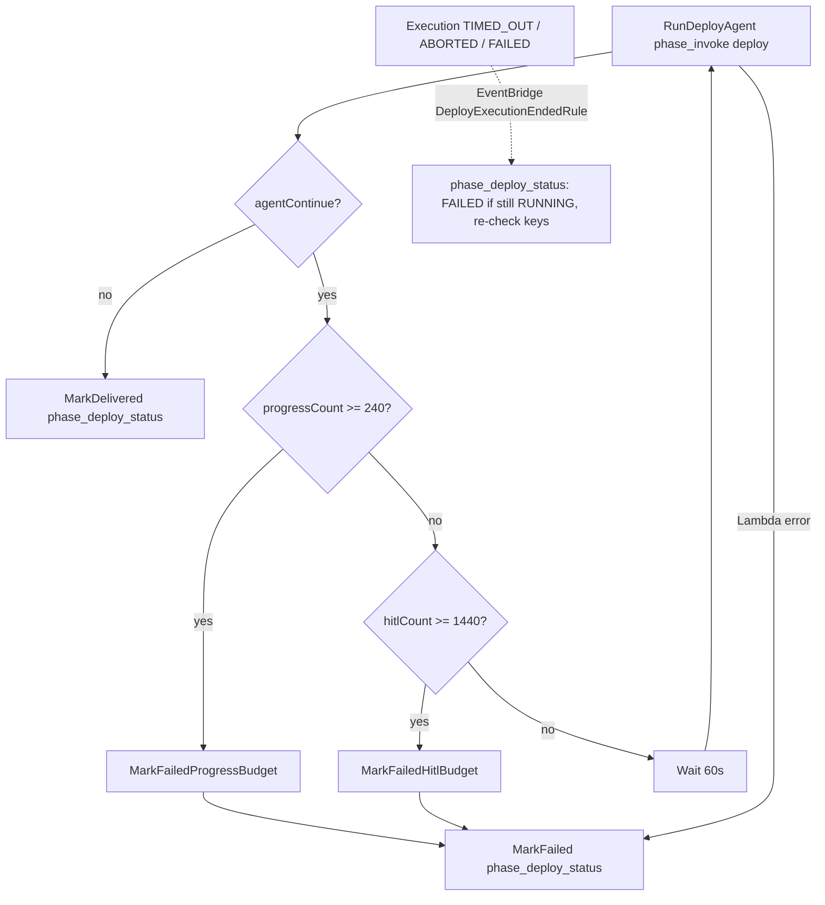

# Deploy workflow — Transform + agent-heavy orchestration

## Architecture

| Layer | Responsibility |
|-------|----------------|
| **Step Functions** (`deployment.asl.json`) | Invoke deploy agent → wait/resume while Transform jobs run or need HITL (capped) → **DELIVERED** / **FAILED** |
| **Strands agent** (`phase: deploy`) | End-to-end deploy procedure via tools + **Transform MCP** |
| **`phase_invoke`** | AgentCore + deterministic **attestation** (`phase_attest` → `deployment-report.json`) |
| **`phase_deploy_status`** | Terminal status (DELIVERED / FAILED) and key cleanup, from `MarkDelivered`/`MarkFailed` and from the EventBridge rule `DeployExecutionEndedRule` (idempotent) |

There are no separate discover / transform / render Lambdas in the deploy state machine.

## End-to-end operator flow

1. Finish a **design run** → **DELIVERED** (scope + IaC zips + validation report).
2. Platform stack has **`TransformWorkspaceId`** (and optionally **`TransformOrchestratorAgent`**).
3. **`POST /runs/{designRunId}/deploy`** → new **deploy run** + start `{ProjectName}-deploy` Step Functions (`runId`, `progressCount: 0`, `hitlCount: 0`).
4. When the deploy run is **DELIVERED**, download artifacts on the **deploy run** id (foundation assessment, IaC plan/manifest, deployment report, optional stack zips).

## Step Functions loop



- **Two budgets.** `phase_invoke` maps the agent's continue payload (contract C3: `reason`, `awaitingHitl`, `jobId`, `pendingHumanInput`) and counts the cycle: `awaitingHitl: false` increments `progressCount` (progress polls, limit 240 ≈ 4 h), `awaitingHitl: true` increments `hitlCount` (waiting on a person in AWS Transform, limit 1440 ≈ 24 h). Both wait 60 s. Each limit fails with its own error, `DeployProgressPollBudgetExceeded` or `DeployHitlWaitBudgetExceeded`, and the cause carries the last reason (and, for HITL, the pending question and console URL).
- **History budget.** One cycle is Task (5 events) + Choice (2) + Wait (2) = 9 events. The worst case is (240 + 1440) × 9 = 15,120 events. The terminal path adds at most 17: the budget Pass (2), `MarkFailed` (5, plus 3 events for each of up to 3 retries) and `Fail` (1). With about 5 start/end events that is about 15,142, well under the 25,000-event Step Functions limit. The counters live in the Lambda payload so the loop needs no Pass states.
- **Wall time.** 1680 cycles × (60 s + invoke time) is about 42 h at 30 s per invoke, inside the 72 h execution timeout. The terminal retries add at most 4 × 120 s (Lambda timeout) + 14 s of backoff.
- **Terminal retries.** `MarkDelivered` and `MarkFailed` retry `Lambda.ServiceException`, `Lambda.TooManyRequestsException`, `Lambda.SdkClientException` and `States.TaskFailed` 3 times (4 attempts) with backoff of 2 s, 4 s and 8 s. The task fails after the last attempt, and the EventBridge rule below picks it up.
- **Executions that never reach `MarkFailed`.** The EventBridge rule `DeployExecutionEndedRule` matches "Step Functions Execution Status Change" for the deploy state machine with status `TIMED_OUT`, `ABORTED` or `FAILED`. It invokes `phase_deploy_status`, which takes the run id from the execution name (contract C11). A run still `RUNNING` is marked `FAILED` with the execution status, error and cause, and its keys are deleted. A run already `DELIVERED` or `FAILED` (by `MarkFailed`, `/stop`, or an earlier attempt) only gets its key cleanup re-checked, with no second status audit. The status write is conditional on `RUNNING`, so it cannot flip `DELIVERED` to `FAILED`. When the event disagrees with the recorded status (say the execution failed because the key delete kept failing after `DELIVERED` was written), that is audited once as `deploy.terminal_status_kept`. If the async invoke still fails after 2 Lambda retries, the event goes to the SQS queue `DeployCleanupDlq` (stack output `DeployCleanupDlqUrl`). That queue should stay empty; a message in it names a run that may still be `RUNNING` or still hold keys. The artifact bucket's lifecycle rule (4 days) stays as the last backstop for keys.
- **Pending human input.** When `awaitingHitl` is true and Transform returned the question, `phase_invoke` writes `META.pendingHumanInput` (`{source, jobId, workspaceId, kind, taskId, title, text, options, consoleUrl}`) and `META.awaitingHitl`, and audits `phase.awaiting_human` (title, text, options, consoleUrl) when the question first appears or changes. The next non-waiting result removes it and audits `phase.human_input_resolved`. `MarkDelivered`, `MarkFailed` and `/stop` clear it too. The UI shows an "AWS Transform needs your input" banner with a link to the job.
- **Attestation** runs inside **`phase_invoke`** when the agent returns `status: ok` (not a separate SFN state).
- If attestation **`overall`** is `fail`, the invoke Lambda errors → SFN → **FAILED**.
- **Terminal cleanup.** `phase_deploy_status` (DELIVERED and FAILED) and `/stop` delete stored deploy-target keys (every S3 version). A failed delete is written to `META.credentialsCleanupError`, audited as `deploy.target_credentials_delete_failed`, and raised. A later successful re-check removes `credentialsCleanupError` and audits the deletion.
- **`/stop` does not cancel Transform jobs.** It stops the execution and marks the run FAILED. The sequencer refuses to start new Transform jobs for a run that is no longer RUNNING, but a job that is already running keeps running; stop it in the Transform console. The `ABORTED` event that follows a `/stop` finds the run `FAILED` and only re-checks the keys. If that event wins the race and marks the run first, `/stop` still records `run.stopped` and returns 200.
- **In-flight invoke after `/stop`.** `phase_invoke` writes `pendingHumanInput`/`awaitingHitl` only while `META.status` is `RUNNING` (conditional update). Otherwise it raises `RunNotRunning` before any audit. If the execution is still alive, `RunDeployAgent`'s Catch sends it to `MarkFailed`, which finds the run already `FAILED` and does not audit it again.

## Agent procedure (`DEPLOY_PROMPT`)

Each invoke starts with **`read_deploy_checkpoint`** and resumes from the last stage. Stable session id: `{deployRunId}-deploy…`.

| Step | Tool / action |
|------|----------------|
| 1 | `run_pre_discover` — org snapshot, gaps, heuristic hint |
| 2 | `transform_init_connection`, `transform_start_analyze` |
| 3 | `transform_poll_analyze_job` (once per invoke; pause if not done / HITL) |
| 4 | `transform_merge_discovery` |
| 5 | Read-only Transform MCP inspect + `save_foundation_assessment`, `save_iac_change_plan` (judgment model) |
| 6 | `render_iac_bundles` |
| 7 | `transform_start_deploy`, `transform_poll_deploy_job` (once per invoke; pause if needed) |
| 8 | `run_post_discover` |
| 9 | `finish_deploy_workflow` → checkpoint `agent_complete` |

Implementation: `agent/deploy_workflow_tools.py`, prompts in `agent/prompts.py`.

## Transform MCP tools (judgment model)

The judgment model (step 5) gets only read-only Transform MCP tools. `agent/transform_mcp.py` filters the server's tool list by exact name against `ALLOWED_TRANSFORM_MCP_TOOLS` = `get_resource`, `list_resources`, `get_status`, `load_instructions` (contract C8). It raises if any of them is missing. Job-control tools are never passed to the model: `create_job`, `control_job`, `delete_job`, `send_message`, `complete_task`, and `get_job_status` (whose summary mode posts a chat message). Every job start and stop goes through the sequencer, behind the C4 `RUNNING` check. IAM still allows `CreateJob`/`StartJob`/`StopJob`/`SendMessage` because the sequencer needs them, so the allowlist is what keeps the model away from them.

MCP startup is preflighted, and a degraded server is never accepted as healthy:

1. Before the subprocess is spawned, the `credential_process` helper command runs once and must print valid `credential_process` JSON. A missing base credential, a trust-policy or external-id mismatch, or an STS error fails here, with the helper's error.
2. After startup, the agent calls the MCP `get_status` tool and requires SigV4 to be configured and connected. Otherwise it raises with the `get_status` output. Without this check the library logs the failed credential probe at info level and starts "unconfigured", and every later call returns `NOT_CONFIGURED`.

## Pause / resume

- Poll tools write **`agent-checkpoint.json`** (`transform_analyze_waiting`, `transform_deploy_waiting`, etc.).
- Agent returns **`continue`** → SFN waits and re-invokes the **same** AgentCore session.
- At most **one** analyze poll and **one** deploy poll **per invoke** (extra polls are refused).

## Attestation (rules, not LLM)

After required S3 artifacts exist (`lzcore/deploy_artifacts.py`), **`phase_attest`**:

- Compares pre/post org snapshots and gaps to the **approved design scope**
- Checks Transform deploy job status from **`transform-poll-deploy.json`**
- Writes **`deployment-report.json`** with `overall`: `pass` | `pass_with_manual_steps` | `fail`

See [deployment-agent-scope.md](./deployment-agent-scope.md) for outcomes and PoC credentials scope.

## Transform 403 (CreateJob / AccessTransformProfile / ListJobs)

A 403 from Transform has two possible causes, and `TransformAccessDenied` names both (contract C9). Check them in this order:

1. **IAM identity policy.** The Transform principal (the AgentRole session, or the `TransformRoleArn` session `ingram-lz-agent`) lacks the IAM action for the operation, e.g. `transform:CreateJob`. CloudTrail shows the call with `errorCode` `AccessDenied`/`AccessDeniedException`, and the error message usually names the action and says no identity-based policy allows it. The fix is the permissions policy (see [Transform IAM actions](#transform-iam-actions)). Workspace membership cannot fix this.
2. **Workspace collaborator role.** IAM allows the call, but the principal is not a **Contributor** (or higher) member of the workspace. The fix is the collaborator mapping below. A policy change cannot fix this.

**IAM:** The Transform identity needs exactly the actions in [Transform IAM actions](#transform-iam-actions). With `TransformRoleArn` empty the stack grants them to **`AgentRole`**; with it set, they belong on the Transform role in the Transform account. Redeploy after template changes.

**Workspace RBAC:** AWS Transform also enforces **workspace collaborator roles**. A 403 on job APIs can mean the role is not a **Contributor+** member of the workspace, even when IAM is correct.

1. Open **AWS Transform** in the **Transform account**: the account of `TransformRoleArn`, or the platform account (same account as the stack) when it is empty.
2. Open workspace **`landing-zone`** (id must match stack `TransformWorkspaceId`).
3. **User access** / **Collaborators** → add the AgentCore execution role as an **IAM principal**:
   - `arn:aws:iam::<platform-account-id>:role/ingram-landing-zone-AgentRole-XXXXXXXX`
4. Assign **Contributor** or **Administrator** (needs **Create Job**).
5. Start a **new** deploy run (failed/paused runs do not pick up access changes).

Service management **IAM-only access** must stay **enabled** (your console screenshot). That is account-level; workspace membership is still required per workspace.

### Add the AgentCore IAM role as a workspace collaborator (required for CreateJob)

IAM on **`ingram-landing-zone-AgentRole-…`** can show **Allow** for `transform:CreateJob` while API calls still return **403** until the role is a workspace member.

1. Sign in to **AWS Transform** as a workspace **Admin** (your SSO user is Admin on **landing-zone** today).
2. Open workspace **`landing-zone`**.
3. **Collaborators** / **User access** → add the **IAM role** (not your SSO user):
   `arn:aws:iam::<platform-account-id>:role/<stack>-AgentRole-<suffix>` (the stack's AgentRole ARN)
4. Assign **Contributor** or **Administrator** (must allow **Create Job**).

PutUserRoleMappings via API fails with “has not logged in to tenant” until the IAM principal is registered in Transform; use the console as Admin, or have the role complete an IAM Transform sign-in once if your tenant requires it.

There is **no** IAM action `transform:StartAnalyzeJob`; the deploy agent uses **CreateJob** + **StartJob**.

## Transform IAM actions

The Transform identity is granted only the job, workspace, message, HITL-task (read) and artifact (download) operations that `lzcore/transform_ops.py` and the Transform MCP read paths call, plus profile access. Keep this list in sync with `AgentRole` in `infra/platform/platform.yaml` (a test checks it).

| Group | Actions |
|-------|---------|
| Workspace (read) | `transform:ListWorkspaces`, `transform:GetWorkspace` |
| Jobs | `transform:CreateJob`, `transform:StartJob`, `transform:StopJob`, `transform:GetJob`, `transform:ListJobs`, `transform:ListJobPlanSteps`, `transform:ListPlanUpdates`, `transform:ListWorklogs` |
| Messages | `transform:SendMessage`, `transform:ListMessages`, `transform:BatchGetMessage` |
| HITL tasks (read) | `transform:ListHitlTasks`, `transform:GetHitlTask` |
| Artifacts (download) | `transform:ListArtifacts`, `transform:CreateArtifactDownloadUrl`, `transform:CreateAssetDownloadUrl` |
| Agents and console (read) | `transform:ListAgents`, `transform:GetAgent`, `transform:GetWebAppUrl` |
| Profile | `transform:AccessTransformProfile`, `transform:ListProfiles` |

Deliberately not granted: `CreateProfile`, `UpdateProfile`, `DeleteProfile`, `UpdateAccountSettings`, `UpdateAgentAccess`, workspace create/update/delete, collaborator mappings (`PutUserRoleMappings`, `DeleteUserRoleMappings`), connectors, `DeleteJob`/`UpdateJob`, artifact upload, and HITL submission (`SubmitStandardHitlTask`, `SubmitCriticalHitlTask`, `UpdateHitlTask`): a person answers Transform's questions in the console. `SendMessage`, `CreateJob`, `StartJob` and `StopJob` are needed by the sequencer (the job prompt, job start and orphan stop). The judgment model cannot reach them, because it gets only the read-only MCP tools (see [Transform MCP tools](#transform-mcp-tools-judgment-model)).

**The narrowed action names are unverified.** The published Service Authorization Reference for the `transform` prefix (v1.5) lists only the profile, connector, agent, account-settings and tagging actions. The job, workspace, message, task and artifact names above follow the Transform API operation names (signing name `elasticgumbyfrontendservice`). `cfn-lint` reports all 18 of them as unknown (W3037). Before this template, `transform:*` covered whatever Transform actually checks. If Transform authorizes under other names, every deploy fails at init or at `CreateJob`.

Confirm the list with one live deploy run before relying on it (before merge, and again after any Transform service change):

1. Start a deploy run against a test target and let it reach at least the analyze poll (ideally the deploy poll).
2. In CloudTrail (Event history, or a trail/Lake query) in the Transform account, filter on the Transform principal: user name `ingram-lz-agent`, the fixed session name. Filter on the principal rather than an event source, because the event source CloudTrail records for these APIs has not been verified either.
3. For each call, compare `eventName` with the list above, and check that `errorCode` is empty. If an `eventName` is missing from the list, or `errorCode` is `AccessDenied`/`AccessDeniedException` with an IAM message, correct the list in `platform.yaml` and here (a test keeps them in sync). Do not widen to `transform:*`.
4. If CloudTrail shows `AccessDenied` that names no IAM action, the cause is workspace RBAC (cause 2 above), not the list.

IAM policy simulation (`aws iam simulate-principal-policy`) checks only that the names are allowed by the policy, not that Transform authorizes under them, so it does not replace the live run. When a call returns 403, the run fails with `TransformAccessDenied`, which names the operation, its IAM action and both causes. Compare it with CloudTrail before widening anything.

**Where the actions live:**

- `TransformRoleArn` empty (Transform in the platform account): `AgentRole` gets the list above, the self-assume trust statement and `AgentSelfAssumePolicy` (fixed session name `ingram-lz-agent`). `AgentRole` keeps its CloudFormation-generated name on purpose: an explicit `RoleName` would replace the role and break the target-account trust policies and the Transform collaborator mapping.
- `TransformRoleArn` set (Transform in another account of the same organization): `AgentRole` gets **no** `transform:*` actions and no self-assume. It gets one `sts:AssumeRole` statement for exactly `TransformRoleArn` (independent of `DeployAssumeRoleArn`). Create the Transform role in the Transform account with the action list above as its permissions policy (`Resource: "*"`) and this trust policy:

```json
{
  "Version": "2012-10-17",
  "Statement": [{
    "Effect": "Allow",
    "Principal": { "AWS": "arn:aws:iam::<platform-account-id>:role/<stack>-AgentRole-<suffix>" },
    "Action": "sts:AssumeRole",
    "Condition": {
      "StringEquals": { "sts:ExternalId": "<TransformExternalId>", "sts:RoleSessionName": "ingram-lz-agent" }
    }
  }]
}
```

Drop the `sts:ExternalId` condition only if `TransformExternalId` is empty. The external id is not a secret (it guards against a confused deputy), so the stack parameter is not `NoEcho`. Add the Transform role (session `ingram-lz-agent`) as a Contributor+ collaborator on the workspace.

## Guardrails

| Guardrail | Value |
|-----------|--------|
| SFN execution timeout | 72 hours |
| Progress-poll budget | **240** cycles × 60 s (`awaitingHitl: false`), ASL `DeployAgentChoice` |
| HITL wait budget | **1440** cycles × 60 s ≈ 24 h (`awaitingHitl: true`), ASL `DeployAgentChoice` |
| Terminal task retries | `MarkDelivered`/`MarkFailed`: 3 retries (4 attempts), 2 s × 2 backoff |
| Terminal cleanup outside the ASL | EventBridge `DeployExecutionEndedRule` → `phase_deploy_status`; failed async invokes → SQS `DeployCleanupDlq` |
| Artifact contract | `lzcore/deploy_artifacts.py` (includes `iac-manifest.json`, post-discover, Transform deploy poll) |
| `phase_invoke` timeout | 900s (agent + attest in one Lambda) |

## Related paths

| Path | Role |
|------|------|
| `orchestration/deployment.asl.json` | Deploy SFN definition |
| `orchestration/lambdas/phase_invoke.py` | AgentCore + attest |
| `orchestration/lambdas/phase_attest.py` | Report builder |
| `lzcore/deploy_workflow.py` | `evaluate_deployment_outcome` |
| `agent/app.py` | Runtime entry (`intake`, `deploy`) |
