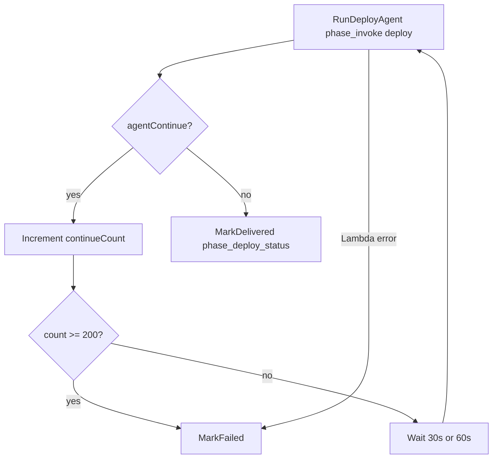

# Deploy workflow — Transform + agent-heavy orchestration

## Architecture

| Layer | Responsibility |
|-------|----------------|
| **Step Functions** (`deployment.asl.json`) | Invoke deploy agent → wait/resume while Transform jobs run or need HITL (capped) → **DELIVERED** / **FAILED** |
| **Strands agent** (`phase: deploy`) | End-to-end deploy procedure via tools + **Transform MCP** |
| **`phase_invoke`** | AgentCore + deterministic **attestation** (`phase_attest` → `deployment-report.json`) |
| **`phase_deploy_status`** | Updates deploy run status in DynamoDB |

There are no separate discover / transform / render Lambdas in the deploy state machine.

## End-to-end operator flow

1. Finish a **design run** → **DELIVERED** (scope + IaC zips + validation report).
2. Platform stack has **`TransformWorkspaceId`** (and optionally **`TransformOrchestratorAgent`**).
3. **`POST /runs/{designRunId}/deploy`** → new **deploy run** + start `{ProjectName}-deploy` Step Functions (`runId`, `continueCount: 0`).
4. When the deploy run is **DELIVERED**, download artifacts on the **deploy run** id (foundation assessment, IaC plan/manifest, deployment report, optional stack zips).

## Step Functions loop

- **Attestation** runs inside **`phase_invoke`** when the agent returns `status: ok` (not a separate SFN state).
- If attestation **`overall`** is `fail`, the invoke Lambda errors → SFN → **FAILED**.

## Agent procedure (`DEPLOY_PROMPT`)

Each invoke starts with **`read_deploy_checkpoint`** and resumes from the last stage. Stable session id: `{deployRunId}-deploy…`.

| Step | Tool / action |
|------|----------------|
| 1 | `run_pre_discover` — org snapshot, gaps, heuristic hint |
| 2 | `transform_init_connection`, `transform_start_analyze` |
| 3 | `transform_poll_analyze_job` (once per invoke; pause if not done / HITL) |
| 4 | `transform_merge_discovery` |
| 5 | Transform MCP inspect + `save_foundation_assessment`, `save_iac_change_plan` |
| 6 | `render_iac_bundles` |
| 7 | `transform_start_deploy`, `transform_poll_deploy_job` (once per invoke; pause if needed) |
| 8 | `run_post_discover` |
| 9 | `finish_deploy_workflow` → checkpoint `agent_complete` |

Implementation: `agent/deploy_workflow_tools.py`, prompts in `agent/prompts.py`.

## Pause / resume

- Poll tools write **`agent-checkpoint.json`** (`transform_analyze_waiting`, `transform_deploy_waiting`, etc.).
- Agent returns **`continue`** → SFN waits and re-invokes the **same** AgentCore session.
- At most **one** analyze poll and **one** deploy poll **per invoke** (extra polls are refused).

## Attestation (rules, not LLM)

After required S3 artifacts exist (`lzcore/deploy_artifacts.py`), **`phase_attest`**:

- Compares pre/post org snapshots and gaps to the **approved design scope**
- Checks Transform deploy job status from **`transform-poll-deploy.json`**
- Writes **`deployment-report.json`** with `overall`: `pass` | `pass_with_manual_steps` | `fail`

See [deployment-agent-scope.md](./deployment-agent-scope.md) for outcomes and PoC credentials scope.

## Transform 403 (CreateJob / AccessTransformProfile / ListJobs)

**IAM:** The platform **`AgentRole`** must allow **`transform:*`** and **`transform:AccessTransformProfile`** (profile / SigV4 path). The stack template includes these; redeploy after template changes.

**Workspace RBAC:** AWS Transform also enforces **workspace collaborator roles**. HTTP **403** on job APIs often means the role is not a **Contributor+** member of the workspace, even when IAM looks correct.

1. Open **AWS Transform** in the **platform account** (same account as the stack).
2. Open workspace **`landing-zone`** (id must match stack `TransformWorkspaceId`).
3. **User access** / **Collaborators** → add the AgentCore execution role as an **IAM principal**:
   - `arn:aws:iam::<platform-account-id>:role/ingram-landing-zone-AgentRole-XXXXXXXX`
4. Assign **Contributor** or **Administrator** (needs **Create Job**).
5. Start a **new** deploy run (failed/paused runs do not pick up access changes).

Service management **IAM-only access** must stay **enabled** (your console screenshot). That is account-level; workspace membership is still required per workspace.

### Add the AgentCore IAM role as a workspace collaborator (required for CreateJob)

IAM on **`ingram-landing-zone-AgentRole-…`** can show **Allow** for `transform:CreateJob` while API calls still return **403** until the role is a workspace member.

1. Sign in to **AWS Transform** as a workspace **Admin** (your SSO user is Admin on **landing-zone** today).
2. Open workspace **`landing-zone`**.
3. **Collaborators** / **User access** → add the **IAM role** (not your SSO user):
   `arn:aws:iam::831493647146:role/ingram-landing-zone-AgentRole-LBinaFbV3RCO`
4. Assign **Contributor** or **Administrator** (must allow **Create Job**).

PutUserRoleMappings via API fails with “has not logged in to tenant” until the IAM principal is registered in Transform; use the console as Admin, or have the role complete an IAM Transform sign-in once if your tenant requires it.

There is **no** IAM action `transform:StartAnalyzeJob`; the deploy agent uses **CreateJob** + **StartJob**.

## Guardrails

| Guardrail | Value |
|-----------|--------|
| SFN execution timeout | 24 hours |
| Max wait/resume cycles | **200** (`MAX_DEPLOY_CONTINUE_CYCLES`, synced with ASL) |
| Artifact contract | `lzcore/deploy_artifacts.py` (includes `iac-manifest.json`, post-discover, Transform deploy poll) |
| `phase_invoke` timeout | 900s (agent + attest in one Lambda) |

## Related paths

| Path | Role |
|------|------|
| `orchestration/deployment.asl.json` | Deploy SFN definition |
| `orchestration/lambdas/phase_invoke.py` | AgentCore + attest |
| `orchestration/lambdas/phase_attest.py` | Report builder |
| `lzcore/deploy_workflow.py` | `evaluate_deployment_outcome` |
| `agent/app.py` | Runtime entry (`intake`, `deploy`) |
