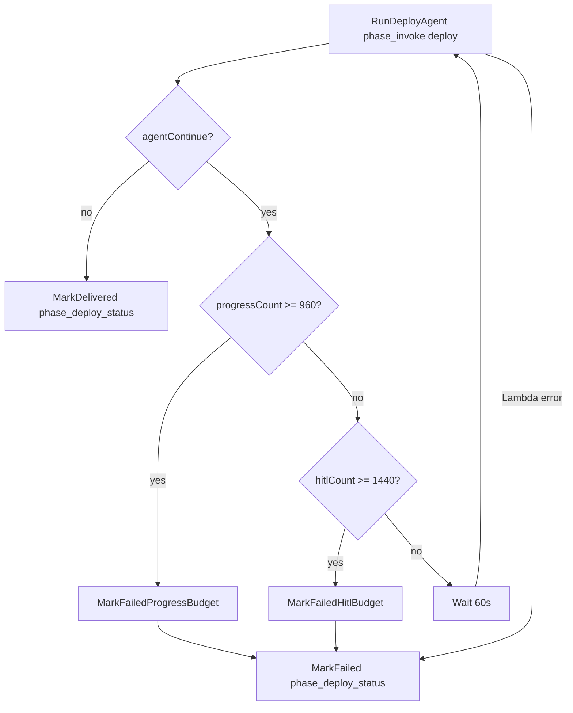

# Deploy workflow — Transform + agent-heavy orchestration

## Architecture

| Layer | Responsibility |
|-------|----------------|
| **Step Functions** (`deployment.asl.json`) | Invoke deploy agent → wait/resume while Transform jobs run or need HITL (capped) → **DELIVERED** / **FAILED** |
| **Strands agent** (`phase: deploy`) | End-to-end deploy procedure via tools + **Transform MCP** |
| **`phase_invoke`** | AgentCore + deterministic **attestation** (`phase_attest` → `deployment-report.json`) |
| **`phase_deploy_status`** | Updates deploy run status in DynamoDB |

There are no separate discover / transform / render Lambdas in the deploy state machine.

## End-to-end operator flow

1. Finish a **design run** → **DELIVERED** (scope + IaC zips + validation report).
2. Platform stack has **`TransformWorkspaceId`** (and optionally **`TransformOrchestratorAgent`**).
3. **`POST /runs/{designRunId}/deploy`** → new **deploy run** + start `{ProjectName}-deploy` Step Functions (`runId`, `progressCount: 0`, `hitlCount: 0`).
4. When the deploy run is **DELIVERED**, download artifacts on the **deploy run** id (foundation assessment, IaC plan/manifest, deployment report, optional stack zips).

## Step Functions loop



- **Two budgets.** `phase_invoke` maps the agent's continue payload (contract C3: `reason`, `awaitingHitl`, `jobId`, `pendingHumanInput`) and counts the cycle: `awaitingHitl: false` increments `progressCount` (progress polls, limit 960 × 15 s ≈ 4 h), `awaitingHitl: true` increments `hitlCount` (waiting on a person in AWS Transform, limit 1440 × 30 s ≈ 12 h). Progress cycles wait 15 s, human waits 30 s. Each limit fails with its own error, `DeployProgressPollBudgetExceeded` or `DeployHitlWaitBudgetExceeded`, and the cause carries the last reason (and, for HITL, the pending question and console URL).
- **History budget.** One cycle is Task (5 events) + Choice (2) + Wait (2) = 9 events. The worst case, (960 + 1440) × 9 = 21,600 events plus about 10 start/end events, stays well under the 25,000-event Step Functions limit. The counters live in the Lambda payload so the loop needs no Pass states.
- **Wall time.** 1680 cycles × (60 s + invoke time) is about 42 h at 30 s per invoke, inside the 72 h execution timeout. An execution that hits the timeout ends without `MarkFailed`, so META stays `RUNNING`; the artifact bucket's lifecycle rule (4 days) is the backstop for stored target keys.
- **Pending human input.** When `awaitingHitl` is true and Transform returned the question, `phase_invoke` writes `META.pendingHumanInput` (`{source, jobId, workspaceId, kind, taskId, title, text, options, consoleUrl}`) and `META.awaitingHitl`, and audits `phase.awaiting_human` (title, text, options, consoleUrl) when the question first appears or changes. The next non-waiting result removes it and audits `phase.human_input_resolved`. `MarkDelivered`, `MarkFailed` and `/stop` clear it too. The UI shows an "AWS Transform needs your input" banner with a link to the job.
- **Attestation** runs inside **`phase_invoke`** when the agent returns `status: ok` (not a separate SFN state).
- If attestation **`overall`** is `fail`, the invoke Lambda errors → SFN → **FAILED**.
- **Terminal cleanup.** `phase_deploy_status` (DELIVERED and FAILED) and `/stop` delete stored deploy-target keys (every S3 version). A failed delete is written to `META.credentialsCleanupError`, audited as `deploy.target_credentials_delete_failed`, and raised.
- **`/stop` does not cancel Transform jobs.** It stops the execution and marks the run FAILED. The sequencer refuses to start new Transform jobs for a run that is no longer RUNNING, but a job that is already running keeps running; stop it in the Transform console.

## Agent procedure (`DEPLOY_PROMPT`)

Each invoke starts with **`read_deploy_checkpoint`** and resumes from the last stage. Stable session id: `{deployRunId}-deploy…`.

| Step | Tool / action |
|------|----------------|
| 1 | `run_pre_discover` — org snapshot, gaps, heuristic hint |
| 2 | `transform_init_connection`, `transform_start_analyze` |
| 3 | `transform_poll_analyze_job` (once per invoke). When Transform asks a question, the conversation agent decides it (see below), then the run waits |
| 4 | `transform_merge_discovery` once the Transform job has finished |
| 5 | Transform MCP inspect + `save_foundation_assessment`, `save_iac_change_plan` |
| 6 | `render_iac_bundles` |
| 7 | `run_post_discover` |
| 8 | `finish_deploy_workflow` → checkpoint `agent_complete` |

There is one Transform job per deploy run. Transform's landing zone workflow plans and applies the landing zone inside that job; there is no second "deploy" job. Its first message is the approved design itself (`deploy_transform.scope_summary_from_scope`: Regions, OUs, accounts, SCPs, controls).

Implementation: `agent/deploy_workflow_tools.py`, `agent/transform_conversation.py`, prompts in `agent/prompts.py`.

## The Transform conversation

Each question the Transform job asks (`pendingHumanInput`, contract C1) goes to the conversation agent (`CONVERSE_SYSTEM`) once. It has two tools and must call exactly one:

- **`answer_transform_question`**: the approved design (category `design`) or the run purpose and context (category `workflow`) answers it. Every `basis` entry must resolve (`scope:<JSON pointer>` or `context:<key>`), and an option must be an offered label. The answer goes through `lzcore/transform_answers.send_answer`, the same `ANSWER#<messageId>` reservation the UI uses, so whoever answers first wins and nothing is sent twice. `transform.answer_sent` is audited with actor `agent`, the category, rationale and basis.
- **`escalate_to_human`**: approval gates (anything that creates, changes or deletes resources, starts a deployment, accepts cost, or cannot be undone), facts the design does not hold (emails, MAP ids), Transform tasks with their own form, and anything uncertain. The reason and suggestion reach META and the UI as `pendingHumanInput.agentNote`.

The approval boundary is enforced in code (`agent/transform_conversation.py`), not only in the prompt. The only thing the agent sends on its own is selecting one of `AGENT_ANSWERABLE_OPTIONS` ("Landing Zone", "Custom structure"), and only when that option is offered exactly once and its value says the same as its label. The agent never sends typed text: a reply that needs text (the custom structure, a confirmation) is escalated with the text as the suggestion, and the person sends it from the card ("Use this as my reply"). Answers are capped per run with an atomic slot (`SLOT_CONDITION`); a slot is given back only when nothing reached Transform. `no_reply_needed` is refused while the job reports `AWAITING_HUMAN_INPUT`; a message judged to need no reply stays visible in the UI as "Update from AWS Transform" with a reply box, and does not count as a wait on a person. A decision recorded in a turn stands even if the model raises afterwards. Transform text, including the previous turn's error, is JSON-escaped (`<`, `>`, `&`) before it enters the prompt.

Target-account connector: the platform (no model) creates a connector for each run (`transform_ops.create_target_connector`, stable idempotency token, supported types in `SUPPORTED_CONNECTOR_TYPES`), shows the AWS console approval link (Transform Region), and submits the critical task only after a person has made the connector ACTIVE. The connector id and a `submitting` mark are recorded before the submit; the submit token is stable per task and connector. The platform role needs the Approver role in the workspace for this.

A reservation in `ANSWER#<messageId>` has a lease (`SENDING_LEASE_SECONDS`). When an abandoned `sending` reservation is taken over, the platform first looks for a USER reply in the job made after it (`transform_ops.user_reply_since`); if one exists it is recorded as sent and nothing is sent again. If Transform accepted a reply but recording it failed, the error is `AnswerRecordFailed` and the answer is never retried or released. Before submitting the connector task the platform notes Transform's newest message, so only messages written before the task are marked handled. `targetRegion` on a deploy run can be set only by an operator (direct Lambda invoke) or a member of the approver group.

Per-question state is the `AGENTQ#<message:id | task:id>` item. A turn that raises or ends without a decision is retried on the next invoke; after `MAX_TURNS_PER_QUESTION` (3) the run fails naming the question. The agent sends at most `MAX_AGENT_ANSWERS_PER_RUN` (40) answers per run; after that every question goes to a person. A question a person already answered in the UI is never given to the model. While the job reports `AWAITING_HUMAN_INPUT`, a Transform message without options is treated as a free-text question.

## Pause / resume

- Poll tools write **`agent-checkpoint.json`** (`transform_analyze_waiting`, etc.).
- Agent returns **`continue`** → SFN waits and re-invokes the **same** AgentCore session.
- At most **one** Transform poll **per invoke** (extra polls are refused).

## Attestation (rules, not LLM)

After required S3 artifacts exist (`lzcore/deploy_artifacts.py`), **`phase_attest`**:

- Compares pre/post org snapshots and gaps to the **approved design scope**
- Checks the Transform job's final status from **`transform-poll-analyze.json`**
- Writes **`deployment-report.json`** with `overall`: `pass` | `pass_with_manual_steps` | `fail`

See [deployment-agent-scope.md](./deployment-agent-scope.md) for outcomes and PoC credentials scope.

## Transform 403 (CreateJob / AccessTransformProfile / ListJobs)

**IAM:** The Transform identity needs exactly the actions in [Transform IAM actions](#transform-iam-actions). With `TransformRoleArn` empty the stack grants them to **`AgentRole`**; with it set, they belong on the Transform role in the Transform account. Redeploy after template changes.

**Workspace RBAC:** AWS Transform also enforces **workspace collaborator roles**. HTTP **403** on job APIs often means the role is not a **Contributor+** member of the workspace, even when IAM looks correct.

1. Open **AWS Transform** in the **platform account** (same account as the stack).
2. Open workspace **`landing-zone`** (id must match stack `TransformWorkspaceId`).
3. **User access** / **Collaborators** → add the AgentCore execution role as an **IAM principal**:
   - `arn:aws:iam::<platform-account-id>:role/ingram-landing-zone-AgentRole-XXXXXXXX`
4. Assign **Contributor** or **Administrator** (needs **Create Job**).
5. Start a **new** deploy run (failed/paused runs do not pick up access changes).

Service management **IAM-only access** must stay **enabled** (your console screenshot). That is account-level; workspace membership is still required per workspace.

### Add the AgentCore IAM role as a workspace collaborator (required for CreateJob)

IAM on **`ingram-landing-zone-AgentRole-…`** can show **Allow** for `transform:CreateJob` while API calls still return **403** until the role is a workspace member.

1. Sign in to **AWS Transform** as a workspace **Admin** (your SSO user is Admin on **landing-zone** today).
2. Open workspace **`landing-zone`**.
3. **Collaborators** / **User access** → add the **IAM role** (not your SSO user):
   `arn:aws:iam::<platform-account-id>:role/<stack>-AgentRole-<suffix>` (the stack's AgentRole ARN)
4. Assign **Contributor** or **Administrator** (must allow **Create Job**).

PutUserRoleMappings via API fails with “has not logged in to tenant” until the IAM principal is registered in Transform; use the console as Admin, or have the role complete an IAM Transform sign-in once if your tenant requires it.

There is **no** IAM action `transform:StartAnalyzeJob`; the deploy agent uses **CreateJob** + **StartJob**.

## Transform IAM actions

The Transform identity is granted only the job, workspace, message, HITL-task (read) and artifact (download) operations that `lzcore/transform_ops.py` and the Transform MCP read paths call, plus profile access. Keep this list in sync with `AgentRole` in `infra/platform/platform.yaml` (a test checks it).

| Group | Actions |
|-------|---------|
| Workspace (read) | `transform:ListWorkspaces`, `transform:GetWorkspace` |
| Jobs | `transform:CreateJob`, `transform:StartJob`, `transform:StopJob`, `transform:GetJob`, `transform:ListJobs`, `transform:ListJobPlanSteps`, `transform:ListPlanUpdates`, `transform:ListWorklogs` |
| Messages | `transform:SendMessage`, `transform:ListMessages`, `transform:BatchGetMessage` |
| HITL tasks (read) | `transform:ListHitlTasks`, `transform:GetHitlTask` |
| Artifacts (download) | `transform:ListArtifacts`, `transform:CreateArtifactDownloadUrl`, `transform:CreateAssetDownloadUrl` |
| Agents and console (read) | `transform:ListAgents`, `transform:GetAgent`, `transform:GetWebAppUrl` |
| Profile | `transform:AccessTransformProfile`, `transform:ListProfiles` |

Deliberately not granted: `CreateProfile`, `UpdateProfile`, `DeleteProfile`, `UpdateAccountSettings`, `UpdateAgentAccess`, workspace create/update/delete, collaborator mappings (`PutUserRoleMappings`, `DeleteUserRoleMappings`), connectors, `DeleteJob`/`UpdateJob`, artifact upload, and HITL submission (`SubmitStandardHitlTask`, `SubmitCriticalHitlTask`, `UpdateHitlTask`): a person answers Transform's questions in the console. Note that `SendMessage` is required to send the job prompt, so the model's MCP tools can still post a chat reply.

Caveat: the published Service Authorization Reference for the `transform` prefix (v1.5) lists only the profile, connector, agent, account-settings and tagging actions. The job/workspace/message/task/artifact names above follow the Transform API operation names (signing name `elasticgumbyfrontendservice`), and `cfn-lint` reports them as unknown (W3037). Before this template, `transform:*` covered whatever Transform actually checks. If a Transform call now returns 403, the run fails with `TransformAccessDenied` naming the operation; compare it with CloudTrail before widening anything.

**Where the actions live:**

- `TransformRoleArn` empty (Transform in the platform account): `AgentRole` gets the list above, the self-assume trust statement and `AgentSelfAssumePolicy` (fixed session name `ingram-lz-agent`). `AgentRole` keeps its CloudFormation-generated name on purpose: an explicit `RoleName` would replace the role and break the target-account trust policies and the Transform collaborator mapping.
- `TransformRoleArn` set (Transform in another account of the same organization): `AgentRole` gets **no** `transform:*` actions and no self-assume. It gets one `sts:AssumeRole` statement for exactly `TransformRoleArn` (independent of `DeployAssumeRoleArn`). Create the Transform role in the Transform account with the action list above as its permissions policy (`Resource: "*"`) and this trust policy:

```json
{
  "Version": "2012-10-17",
  "Statement": [{
    "Effect": "Allow",
    "Principal": { "AWS": "arn:aws:iam::<platform-account-id>:role/<stack>-AgentRole-<suffix>" },
    "Action": "sts:AssumeRole",
    "Condition": {
      "StringEquals": { "sts:ExternalId": "<TransformExternalId>", "sts:RoleSessionName": "ingram-lz-agent" }
    }
  }]
}
```

Drop the `sts:ExternalId` condition only if `TransformExternalId` is empty. The external id is not a secret (it guards against a confused deputy), so the stack parameter is not `NoEcho`. Add the Transform role (session `ingram-lz-agent`) as a Contributor+ collaborator on the workspace.

## Guardrails

| Guardrail | Value |
|-----------|--------|
| SFN execution timeout | 72 hours |
| Progress-poll budget | **960** cycles × 15 s ≈ 4 h (`awaitingHitl: false`), ASL `DeployAgentChoice` |
| HITL wait budget | **1440** cycles × 30 s ≈ 12 h (`awaitingHitl: true`), ASL `DeployAgentChoice` |
| Artifact contract | `lzcore/deploy_artifacts.py` (includes `iac-manifest.json`, post-discover, final Transform job poll) |
| `phase_invoke` timeout | 900s (agent + attest in one Lambda) |

## Related paths

| Path | Role |
|------|------|
| `orchestration/deployment.asl.json` | Deploy SFN definition |
| `orchestration/lambdas/phase_invoke.py` | AgentCore + attest |
| `orchestration/lambdas/phase_attest.py` | Report builder |
| `lzcore/deploy_workflow.py` | `evaluate_deployment_outcome` |
| `agent/app.py` | Runtime entry (`intake`, `deploy`) |


## Conversation agent: what it sends and what a person sends

* **Options it selects itself** (`AGENT_ANSWERABLE_OPTIONS`, enforced in code, fails closed): Landing Zone, Custom structure, My own structure, Get started, Create a Control Tower landing zone (recommended), Recommend additional SCPs, None (skip). Everything else (Proceed, Continue, Deploy for me, any new label) goes to a person.
* **Typed replies**: only for a message that offers no options, with facts from the approved design or run context, each citing its basis. A separate reviewer model call (`REVIEW_SYSTEM`, one tool `report_reply_review`) must say the reply approves nothing irreversible; an error, no verdict or an unsure verdict refuses the reply. The reviewer is a model check, not a code rule: tasks and the option list above are the code-enforced part.
* **Suggestions** are typed: `option` and `approval` must equal an offered label (a person confirms before it is sent), `text` is a typed reply for a message without options, `steps` is for a task. Explanations go in `reason`.
* **Account email**: `accountEmail` (`prefix@domain`, no `+`) on the deploy request is stored as `META.accountEmailBase` and offered to the agent as `context:accountEmailBase`. Without it the email question goes to a person.

## When Transform says the build is done

AWS Transform can post its final summary ("Your landing zone is complete…") and still report the job as `EXECUTING`. The run would then wait forever. The split of work:

* **The conversation agent** recognises the summary and calls `report_build_complete(reason, basis)`, citing the design entries it says are deployed. It closes nothing; it has no tool that stops or changes a job.
* **The platform** (`_verify_build`) checks the target account with `lzcore.deploy_workflow.verify_landing_zone`: every design OU and account exists, every design account is `ACTIVE`, and one Control Tower landing zone in the run's Region (`targetRegion`, else the design's home Region) is `ACTIVE`. An unreadable account is a step error, never "not built".
* **Match:** the checkpoint becomes `transform_build_verified`; the next step (`transform_close_job`) calls `StopJob` and moves to `transform_analyze_done`, and the run continues with merge, judgment, render and attestation. If `StopJob` fails, the job's own status decides: already closed moves on, still open fails naming the job.
* **No match:** the UI shows what is missing as an update and the platform checks again on each poll (Transform may still be finishing), up to `MAX_BUILD_VERIFICATIONS` (15). Then it is handed to a person with the missing items, and nothing is closed.

Audit events: `transform.build_reported_complete`, `transform.build_verified`, `transform.build_verification_failed`, `transform.job_closed`. A deploy role in role mode needs `controltower:ListLandingZones` and `controltower:GetLandingZone` for this check.

## Fewer questions, safer gates (v31)

* **First message.** Besides the design, the opening message to Transform has a "Decisions already made" section (`lzcore.deploy_transform.decisions_section`): Landing Zone only, the design's structure as "My own structure", a Control Tower landing zone in the run's Region, the account email base, the MAP answer, and whether to stage SCPs. Only what the operator gave is stated. Execution, the connector and the final deployment are still approved by a person. Whether Transform follows it is measured per run (count the hand-offs).
* **SCP choice.** The deploy form has an **Apply SCPs** checkbox (ticked by default; API `applyScps`, CLI `--apply-scps/--no-apply-scps`). Ticked: the agent selects "Recommend additional SCPs" and then the option that stages all recommended ones. Unticked: it skips them. Not sent: the question goes to a person.
* **Options.** `EXECUTION_GATE_OPTIONS` (Proceed, Deploy for me, Approve, Approve proposal) are refused in code for the agent, always. Other options in `AGENT_ANSWERABLE_OPTIONS` are sent directly; any other option is judged by the independent reviewer (`REVIEW_SYSTEM`, which sees the question, the conversation and the approved design) and sent only when it says the choice starts nothing. The reviewer treats giving or confirming design content as facts, not approvals. A reviewer error refuses the option.
* **Pre-flight** (`lzcore.preflight`, run inside `run_pre_discover` before any Transform job exists): a `Security` OU without a Control Tower landing zone, an `AtxLzBootstrapStack` in a failed or in-progress state, IAM Identity Center not enabled in the Region, and planned account emails already used by a live account. Blockers fail the run with the list. Checks the account does not permit are audited as `unverified`, never counted as passed. The deploy role needs `cloudformation:DescribeStacks` and `sso:ListInstances` for these two checks.
